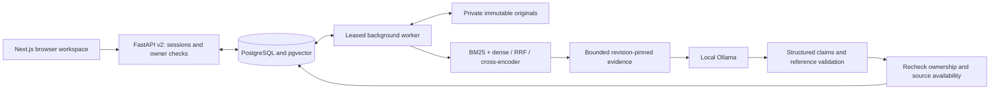

# Architecture

## Research workspace



Collections scope the same active revision set for both retrieval branches.
Source selection is saved with a conversation. Dense search uses pgvector;
BM25 uses a bounded revision-keyed cache. Search exposes passages directly;
Q&A jobs preserve their selected evidence across retries. The default worker
serializes generation and yields between summary steps to prioritize questions.

Q&A `qa-v4` requests bounded JSON claims with supporting passage numbers and an
explicit insufficient-evidence flag. Independent validation rejects malformed
claims, out-of-range or non-integer references, and abstentions that also assert
facts. Hyphenated numeric identifiers must match their cited passages; a mismatch
gets specific repair feedback. The server builds citation markers after validation.
One repair is allowed; persistent invalid responses become `unsupported`.
After an abstention, up to three passage checks can select exact excerpts.
The server validates their reference, literal text, and word/number boundaries,
and labels them `quoted_evidence`, which may address only part of a question.
Missing answers retain their abstention state. These checks do not establish
general semantic entailment. Generated claims still need passage review.

Summaries (`summary-v3`) checkpoint all extracted passages, then synthesize
structured fields with explicit method, dataset, result, and limitation meanings.
If synthesis empties a dimension that contains mapped claims, a validated mapped
claim is retained with its original references. This prevents complete erasure
of a reported dimension; it does not promise exhaustive summaries or entailment.
Calls reserve output/tokenizer space and use 2K context when it fits, otherwise
4K; oversize input fails explicitly rather than silently truncating evidence.
Saved comparisons display separately cited summary dimensions for 2–5 sources;
they do not invent cross-dataset performance rankings. Notes use optimistic
versions and export user text, selected findings, and reference locators. Source
deletion or detachment masks unavailable evidence without removing note text.

Originals stay outside frontend assets. PostgreSQL coordinates imports, revision
publication, job leases, and storage cleanup. Backup uses an exported database
snapshot and storage coordination, with a verified restore into a separate DB.
Source tags and reading progress belong to the account's source record and are
shared across collections. Changed content resets progress only on successful
publication. Metadata forms can reject revision conflicts. API readiness and
the normal worker require the current migration head before operating.
The browser pairs extracted pages with Q&A on wide screens and stacks the panes
on mobile. Recorded answer stages include the initial queue wait, retained across
retries, plus retrieval/rewrite and generation/evidence-check durations.
See [the release runbook](LOCAL_RELEASE.md) and [the implementation plan](RESEARCH_WORKSPACE_PLAN.md).

The default local model is Qwen3 4B. Compose serializes inference and disables
the pinned runner's host cache of old prompts and context checkpoints to bound
memory on small hosts. GPU access is an optional override; layer placement is
separately configurable and must be verified against the model and context size.

## Legacy single-user assistant

The following sections describe the preserved Streamlit/Chroma application. It
has a separate library and API; its limitations do not describe v2 accounts.

```text
Streamlit --HTTP--> FastAPI (one pipeline, initialized on first use)
                         |
                         +--> file parsing / encoder-aware chunking
                         |        --> embeddings --> persistent Chroma
                         |                              |
                         |                  reconstruct in-memory BM25
                         |
                         +--> query rewriting --> intent routing
                                  |                  |
                                  |          small talk / web search
                                  v
                            dense and/or BM25
                                  |
                             RRF (hybrid)
                                  |
                           optional cross-encoder
                                  |
                       bounded evidence --> Ollama --> validated citation IDs
```

## Initialization and ownership

Importing the API initializes no models and opens no document database.
`create_app` accepts a pipeline factory; tests substitute model behavior without
running external services. The pipeline opens Chroma when first requested and
loads the embedding and cross-encoder models only when their work is needed.
Shutdown closes database and HTTP clients and retains application data.

## Persistence and document identity

Chroma stores chunk text and metadata (`source`, `filepath`, `file_hash`,
`chunk_index`, and `page` for PDFs). Original upload names map to generated saved
filenames through this metadata. A filename identifies a logical document;
different content uploaded under that name replaces it. Legacy chunk IDs remain
compatible with dense/sparse fusion. Rebuild normalizes legacy duplicate aliases
when an original filename survives in metadata.

BM25 is derived from Chroma on startup, so sparse and dense retrieval share the
same persisted corpus and custom database paths cannot accidentally load a global
pickle. Standalone sparse JSON persistence is available, but the pipeline does
not rely on a second independently persisted index. BM25 uses positive IDF so
small collections do not produce zero/negative relevance for matching terms.

## Writes and recovery

A pipeline lock serializes document changes and retrieval within one process.
The new corpus, embeddings, and sparse index are prepared before persistent
replacement. Replacement removes obsolete IDs; recoverable storage exceptions
restore the previous records. Files being replaced or deleted are staged under
a non-indexable extension and restored if the write fails. On startup, recognized
staged files are restored or removed according to whether Chroma still references
their original paths.

This provides tested recovery for ordinary exceptions and interrupted file staging.
It is not an atomic transaction across Chroma calls and filesystem changes. Power
loss midway through a multi-batch write, out-of-disk rollback failures, multiple API
workers, or external processes modifying the same files are outside that guarantee.
Backups and a dedicated transactional document registry remain appropriate before
multi-user production deployment. Mutations should go through this single API.

## Retrieval and generation

Ingestion uses the embedding model's tokenizer and maximum sequence length,
including special tokens, so passages do not silently exceed the encoder input
limit. Standalone chunking uses tiktoken. Both enforce overlap, preserve Unicode,
and assign unique chunk indices across a PDF's pages.

Reranking flags are request-local and work with dense-only or hybrid retrieval.
They never modify the shared hybrid retriever. Evidence passed to generation is
bounded with a tiktoken estimate, with reserved room for instructions, output, and
tokenizer differences; this is not an exact count for Ollama's tokenizer.

Generation instructions treat retrieved text as untrusted evidence. Citation IDs
are range-checked against the evidence actually sent, and responses without usable
citations are withheld. References include the original name and page metadata,
excluding internal file paths. These checks validate reference identity; they do
not prove that a cited passage semantically supports every generated claim or
fully prevent prompt injection.

Summarization still uses retrieved top-k passages; it is not an exhaustive summary
of every uploaded page. Web search uses result snippets, not full-page extraction.

## Deployment scope

Use one backend worker with one local user's documents. There are currently no
accounts, per-user collections, authorization, or public-service abuse controls.
Liveness is separate from readiness; readiness checks model availability but not
inference accuracy. The web route contacts DuckDuckGo; local document routes use
the prepared local models and database.
