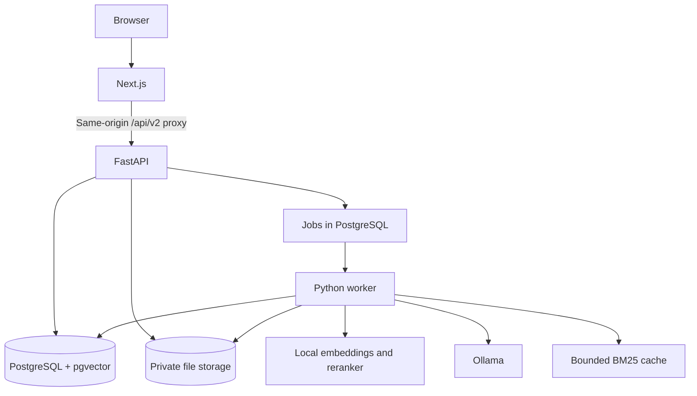

# Research Workspace — Implementation Plan

Status, 22 November 2026: the local release's application workflow is implemented.
Accounts, collections, versioned imports/refresh/replacement, deletion, hybrid
retrieval, source-scoped conversations, revision-pinned summaries, descriptive
comparisons, notes/export, service diagnostics, and backup/restore are available.
Leased jobs fence stale attempts and checkpoint summaries. Test evidence and
remaining accuracy limits are recorded in
[WORKSPACE_VERIFICATION.md](WORKSPACE_VERIFICATION.md). Follow
[LOCAL_RELEASE.md](LOCAL_RELEASE.md) to run it. Measured resource findings are in
[PERFORMANCE_NOTES.md](PERFORMANCE_NOTES.md).

The completion pass adds a responsive extracted-text reader beside Q&A, visible
processing times, question-draft protection during submission, literal numeric
identifier checks, and labeled exact-excerpt responses. The initial queue wait is
saved before retrieval and retained across retries.
Source tags and reading progress are owner-scoped and shared across collections.
Successful content changes reset reading progress; tags survive refresh/replacement.
Metadata forms check the revision they were opened against before saving.

The following release choices make the original proposal concrete:

- Comparisons preserve separately cited summary fields for 2–5 sources in a
  saved evidence table. They do not generate an additional cross-source score or
  automatically assert contradictions. Dataset/metric compatibility needs review.
- The workspace accepts one file per upload, limited to 10 MB. The retained
  legacy assistant's ten-file/25 MB batch API is separate.
- The browser opens authorized original PDFs with page locators; precise PDF
  highlights and a synchronized PDF pane remain deferred. Extracted pages and
  Q&A appear side by side on desktop and stack on smaller screens.
- FastAPI defines an OpenAPI schema through `app.openapi()`; public documentation
  endpoints remain disabled. Frontend types are maintained in `lib/api.ts`.
  Automatic client generation is a future maintenance improvement.
- The 37-question development corpus and separate 32-question validation corpus
  are fictional, with mixed paper-like and article-like sources. They exercise
  regression coverage and retrieval modes. Reports are tied to corpus fingerprints.
  Real-paper domain accuracy and semantic answer support require a separate
  reviewed evaluation; structural citation checks alone cannot establish them.

## Outcome and agreed decisions

The five planned milestones are implemented and verified for the local release:

| Milestone | Acceptance evidence |
| --- | --- |
| Accounts and library | Real account/collection browser flows; session, throttling, and ownership checks |
| Imports and revisions | Real upload/extraction/indexing; controlled article/PDF fixtures; replacement, refresh, deletion, metadata, and migration checks |
| Hybrid retrieval and Q&A | Four real retrieval modes on two corpora; cited real-model answers and follow-up; scope and stale-job tests |
| Reader and research tools | Desktop/mobile reading panes; saved summaries, comparisons, notes/export, revision pinning, tags and reading progress |
| Local release and evaluation | 430 regression tests, nine PostgreSQL checks, six browser scenarios, 69 reviewed generation cases, verified backup/restore, and documented startup/recovery |

Model quality limits remain explicit in the evaluation report; the release does
not claim universal answer correctness or production readiness.

Extend the existing RAG project into a workspace for collecting, reading, questioning, and comparing research papers, blogs, and articles. The demonstration must let a user import a PDF and article URLs, organise them into a collection, ask a cited question, compare their findings, and save a research note.

| Decision | Default |
| --- | --- |
| Interface | Next.js with TypeScript; FastAPI owns application logic |
| Audience | Individual accounts with private collections |
| Sign-in | Case-insensitive email or username and password; an account may have either identifier or both |
| Password rule | 8–128 characters; allow spaces and Unicode, with no required character mix |
| Usernames | 3–32 ASCII letters, numbers, dots, underscores, or hyphens; case-insensitive |
| Email verification | Not required for the local demonstration |
| Session lifetime | Seven days after sign-in, without automatic extension |
| Multiple devices | Allow multiple active sessions |
| Deployment | Local Windows demonstration first |
| Generation | Local Ollama; configurable `qwen3:4b-instruct-2507-q4_K_M` release profile |
| Embeddings | Existing local `all-MiniLM-L6-v2` model |
| Reranker | Existing `cross-encoder/ms-marco-MiniLM-L-6-v2` |
| Retrieval | BM25 + pgvector semantic search, RRF, then reranking |
| Persistence | PostgreSQL with pgvector; SQLAlchemy and Alembic |
| Originals | Private local storage outside frontend assets |
| Background work | One Python worker using PostgreSQL job records |
| Existing library | Fresh v2 library; preserve legacy files and indexes |
| Initial language | English |

The first release includes uploads, public article URL imports, collections, source metadata, persistent Q&A, source summaries, comparisons of 2–5 sources, notes, and Markdown export. Team sharing, web discovery, OCR, mathematical interpretation, figure analysis, exact PDF highlight overlays, and a public hosting rollout are deferred.

## Existing foundation and code boundaries

The repository already has document loaders, tokenizer-aware chunking, local embeddings, Chroma persistence, BM25, RRF, a cross-encoder, Ollama generation, citation mapping, a FastAPI API, Streamlit, and regression tests. Current summaries use retrieved passages rather than exhaustive section coverage. The current API has a shared single-user corpus and performs imports synchronously.

Implement v2 alongside the existing application:

- Add `frontend/` for Next.js and `src/workspace/` for v2 application modules.
- Group Python modules by auth, library, ingestion, retrieval, research, jobs, and persistence. Share services between API routes and the worker; route handlers remain thin.
- Reuse tested parsing, tokenisation, embedding, RRF, reranking, and Ollama utilities through adapters. Refactor shared code only when needed, retaining legacy regression coverage.
- Provide a separate v2 FastAPI entrypoint. Its public surface contains only authenticated v2 application routes and minimal health endpoints; do not mount legacy unauthenticated routes.
- Use a new PostgreSQL database and separate private storage directory. Do not import existing Chroma data or reset current repository changes.

## Target architecture

PostgreSQL is authoritative for ownership, active revisions, text chunks, vectors, jobs, and results. BM25 is a derived, disposable cache. Begin with exact cosine search over authorised pgvector rows; approximate indexing is a measured later optimisation. Native PostgreSQL text ranking does not replace BM25.

## Milestone 1 — Accounts and persistent library

### Work

- Establish the v2 application factory, configuration, migrations, PostgreSQL service, and frontend shell.
- Implement registration, login, logout, and current-user lookup with Argon2id password hashes and opaque server-side sessions. Store hashed session tokens; send cookies as HttpOnly and SameSite=Lax. Secure cookies are required with HTTPS; local HTTP uses an explicit development setting.
- Add origin/CSRF protection for mutations, persistent login throttling, and ownership checks at the service/repository boundary.
- Implement collections and the source-library UI. The browser never supplies the authoritative owner ID.
- Add database entities described below and generate the initial migration.

### Data model

| Entity | Essential information |
| --- | --- |
| User / session | Account, password hash, token hash, expiry, revocation |
| Collection | Owner, name, description |
| Source | Owner, type, title, authors, publication date, original URL, tags, reading status, active revision, deletion marker |
| Collection source | Collection/source association, unique within a collection |
| Source revision | Source, content hash, extraction version, status, timestamps, original/extracted storage keys, embedding model identifier |
| Chunk | Revision, stable ID, ordinal, section, page/paragraph locator, text, embedding |
| Conversation / message | Owner, collection/selected-source scope, role, content, status |
| Citation | Message or analysis, source revision, chunk, evidence locator |
| Analysis | Owner, type, selected revisions, structured result, model/prompt versions |
| Note | Owner, collection, Markdown, attached source/citation references |
| Job | Owner, kind, payload, status, progress, priority, attempt count, lease, checkpoint, result reference |

Use UUIDs for identities. Enforce ownership relationships and unique membership/revision constraints in database operations. Embedding dimensions must match the configured model; changing models requires rebuilding compatible revisions.

### Done when

Two users can sign in, create collections, and see only their own records. Tests deny cross-account reads and writes through guessed IDs. Sessions can be revoked. A fresh database can be created entirely through migrations.

## Milestone 2 — Background imports and source revisions

### Work

- Build a PostgreSQL queue using transactional job creation, row locking, leases, heartbeats, and bounded retries. Default to one worker; transient failures get at most three attempts, while invalid input fails immediately.
- Make job stages idempotent. Claim/checkpoint transactions remain short; do not hold database locks while fetching pages or invoking models.
- Accept one file per workspace upload, limited to 10 MB. Validate supported types and store originals under generated private paths. The legacy batch API remains separate.
- Retain PDF, DOCX, TXT, and Markdown parsing. Use a controlled HTTP fetcher plus Trafilatura for public HTML articles; route a URL serving a PDF through the PDF parser.
- The URL fetcher permits public HTTP/HTTPS destinations, rejects credentials and private/link-local/loopback addresses, validates DNS and every redirect, binds the connection to a validated destination, and limits time and decompressed response size. Default to three redirects, a 30-second operation timeout, and 10 MB responses. Do not inherit ambient proxy settings or forward user credentials.
- Extract source metadata as optional fields; allow correction. Treat missing dates/authors as unknown. Preserve page and paragraph references, and render extracted articles as sanitised content.
- Identify section boundaries where feasible; fall back to ordered page or paragraph groups. Maintain tokenizer-aware chunk limits and embedding generation.
- Stage files and revision records before processing. Publish a fully indexed revision by switching the source's active-revision pointer in one database transaction. Reconcile orphaned staged files during cleanup; filesystem and database writes are not one atomic transaction.
- Deduplicate identical imports within an account. A filename is display metadata, not identity. A repeated import can attach the existing source to another collection. Refresh/replacement explicitly targets a source and creates a new revision when content differs.
- Replacement decision: if the proposed file matches a different source in the same account, reject it and leave both sources unchanged. File replacements are staged, indexed, and atomically published; their prior revisions and filenames remain available to saved evidence. Failed attempts retain the current source and can be retried with another upload. The worker reconciles abandoned staged files and generated files without database references, with a 24-hour grace period for the latter.
- Deletion immediately excludes the source from retrieval, cancels pending work, and schedules derived-data/file cleanup. Retained answers and notes show unavailable evidence; deleted content is not reused as fresh evidence.

### Done when

The UI shows queued, processing, ready, and failed sources. Users can import supported files and public articles. Invalid or unreadable documents cannot become searchable. Failed refreshes retain the previous active revision. Restarting a worker does not create duplicate published revisions. URL-security and oversized-response cases are covered by controlled fixtures.

## Milestone 3 — Scoped hybrid retrieval and cited Q&A

### Work

- Resolve collection or selected-source IDs into authorised active revisions. Persist the resolved revision set for each job. Recheck deletion and ownership before publishing or returning its result.
- Retrieve over the same revision snapshot in both branches: exact pgvector cosine search and the existing BM25 implementation, including its positive-IDF treatment for small corpora.
- Build BM25 from PostgreSQL chunk records for the selected scope. Use an LRU cache keyed by owner, sorted revision IDs, and tokenizer version, with a configurable memory budget. Refreshes create new keys; deletion invalidates affected entries. Check authorisation even on cache hits.
- Start with up to 20 candidates per branch, RRF with the existing constant of 60, cross-encoder reranking of the deduplicated union, and up to six final passages subject to the context budget. These are explicit initial settings to evaluate, not claimed optimal values.
- Support dense-only, BM25-only, hybrid, and hybrid-plus-reranking configurations for evaluation. The application default is hybrid plus reranking.
- Reuse conversation query rewriting for follow-ups, retaining the original question. Stored assistant messages are conversational context, not authoritative evidence.
- Assemble prompts with numbered evidence, source IDs, locators, and bounded context. Treat imported content as evidence rather than instructions. Keep Ollama as the only generation provider.
- Request bounded structured answer claims and reference numbers, and validate them against the actual evidence before rendering citation markers. Invalid structure/references trigger one repair attempt, then an explicit unsupported-answer result. No retrieved evidence and model-reported insufficient evidence are distinct states; abstention does not require fabricated citations. Structural validation does not establish semantic correctness.
- Persist messages, evidence references, model identity, prompt version, retrieval configuration, and timing data. Return completed answers after validation rather than streaming unvalidated answer tokens.

### Done when

Users can ask a question against a collection or selected sources, reopen conversations, and inspect cited evidence. Tests cover follow-ups, empty libraries, unanswerable questions, scope leakage, cache invalidation, stale jobs, invalid citations, and Ollama failure. Dense and BM25 results use identical stable chunk identities.

## Milestone 4 — Research reader, summaries, comparisons, and notes

### Work

- Build a reader with source content beside Q&A. Serve PDFs through an authenticated content endpoint and open citations at their page. For articles, display the saved extracted passage and original URL. Preserve old revisions while referenced, until explicit source deletion.
- Summarise a source by processing all extracted sections in bounded batches and synthesising section-level outputs. Carry original evidence IDs through each stage. Report incomplete extraction or failed sections instead of implying complete coverage.
- Use source-appropriate summary fields: question/argument, approach, evidence, findings, and author-reported limitations. Missing fields remain explicitly unreported.
- Compare 2–5 selected sources with evidence collected separately for each comparison dimension and source. Include dataset, metric, and evaluation conditions beside numerical results; do not infer comparable performance from mismatched experiments.
- Checkpoint long analyses between model calls. The worker prioritises waiting Q&A jobs between analysis batches; one generation call runs at a time.
- Save comparison results and summaries as analysis records pinned to source revisions. Label possible disagreements as interpretations supported by passages, not automatically verified contradictions.
- Add editable research notes and Markdown export. Export includes only the user's saved note content, selected findings, and references; it does not reproduce entire imported sources.

### Done when

One PDF and two articles can be imported, read, summarised, compared, and cited in a saved/exported note. Each comparison source has evidence or an explicit missing-evidence state. An interrupted analysis resumes from a valid checkpoint. Source refreshes do not silently rewrite existing citations.

## Milestone 5 — Evaluation and complete local demonstration

### Work

- Keep the current regression suite and small synthetic retrieval benchmark as smoke tests. Add v2 tests using an isolated PostgreSQL database, temporary file storage, and mocked external/model responses.
- Add browser tests for registration, collection creation, PDF/URL import, questions, source inspection, comparison, notes, export, and logout.
- Build a reviewed evaluation set of at least 30 questions across a mixed corpus of papers and articles. Include exact terminology, paraphrases, multi-source comparisons, missing answers, and misleading retrieved instructions. Keep a separate development set for tuning.
- Compare dense-only, BM25-only, hybrid, and reranked hybrid using Recall@k, MRR/nDCG, and retrieval latency. Review answer correctness, citation support, summary coverage, and appropriate abstention separately.
- Record generation latency, job waiting time, peak memory, model versions, and hardware. Do not claim a universal latency or accuracy target from the existing synthetic benchmark. Fix observed failures before making portfolio claims.
- Extend CI with PostgreSQL/pgvector integration tests and frontend checks. Keep real Ollama evaluation opt-in and document the reproducible command; CI should not require a live inference service.
- Add structured request/job logs without document bodies, prompts, credentials, or signed URLs. Include queue health, worker heartbeat, storage status, and model availability in appropriate readiness checks.
- Document installation, model preparation, migrations, service startup, backup/restore, and failure recovery. PostgreSQL runs through Compose; Ollama can use the optional Compose inference service. Next.js, FastAPI, and the worker run on the local host initially.

### Done when

The complete demonstration works from a documented fresh setup. Isolation and failure-recovery tests pass. Benchmark results include the dataset scope and hardware. Database plus private-file backups can be restored into a separate local instance. No unsupported production-readiness claim is made.

## API contract outline

The v2 API uses same-origin frontend proxying. Application resources require a session; health/readiness remain public. Unowned IDs return a generic not-found response. Long-running import/question/summary requests use operation-specific request keys or content/revision deduplication. Notes use optimistic versions; comparisons create separate saved records.

| Method and route, under `/api/v2` | Behaviour |
| --- | --- |
| POST `/auth/register`, `/auth/login`, `/auth/logout`; GET `/auth/me` | Manage account sessions |
| GET/POST `/collections`; GET/PATCH/DELETE `/collections/{id}` | Manage private collections; deleting a collection removes associations, not library sources |
| POST/DELETE `/collections/{id}/sources/{source_id}` | Attach/detach an owned source |
| GET `/sources`; GET `/collections/{id}/sources`; POST `/collections/{id}/sources/upload`, `/collections/{id}/sources/import-url` | List sources and create asynchronous imports |
| GET `/sources/{id}/text`; PATCH/DELETE `/sources/{id}` | Read extracted text, edit metadata, or delete a source |
| POST `/sources/{id}/refresh`; POST `/sources/{id}/replace` | Refetch an article or upload replacement content explicitly |
| GET `/sources/{id}/content?revision_id=...` | Deliver authorised original/extracted content |
| GET/POST `/collections/{id}/conversations`; GET `/conversations/{id}` | Persist a scoped conversation |
| POST `/conversations/{id}/messages` | Save a user message and queue its answer |
| GET/POST `/sources/{id}/summaries`; GET `/analyses/{id}` | Request and read a source summary |
| GET `/collections/{id}/research`; POST `/collections/{id}/comparisons`; GET `/comparisons/{id}` | List findings and save/read evidence comparisons |
| GET `/jobs/{id}` | Return owner-scoped status, stage, progress, and result reference |
| GET/POST `/collections/{id}/notes`; GET/PATCH/DELETE `/notes/{id}`; GET `/notes/{id}/export` | Save and export findings |
| GET `/health`; GET `/ready` | Liveness and dependency readiness |
| GET `/status` | Authenticated database/worker/storage/model diagnostics |

Long operations return `202` with `job_id` and relevant resource IDs. The browser polls pending work at two-second intervals and exposes failures. Responses expose safe error codes/messages; internal paths and exceptions stay server-side. Actual routes are collection-scoped for creation/listing. FastAPI's `app.openapi()` can generate the local contract; public documentation endpoints remain disabled. Frontend types are maintained in `frontend/lib/api.ts`.

## Acceptance gate and project sequence

Milestones are sequential: accounts/library → ingestion → retrieval/Q&A → analysis tools → evaluation/demo. Each milestone includes its own backend and UI work and tests. Complete the relevant end-to-end path before starting the next milestone.

The release gate is a reproducible demonstration plus passing isolation, lifecycle, citation-identity, and recovery tests. Semantic answer quality requires the reviewed evaluation report; passing structural checks alone is insufficient.

Record measured changes as results become available. A strong final project account should explain the choice of hybrid retrieval, cache invalidation, versioned evidence, background execution, and the tradeoffs of running generation locally.
